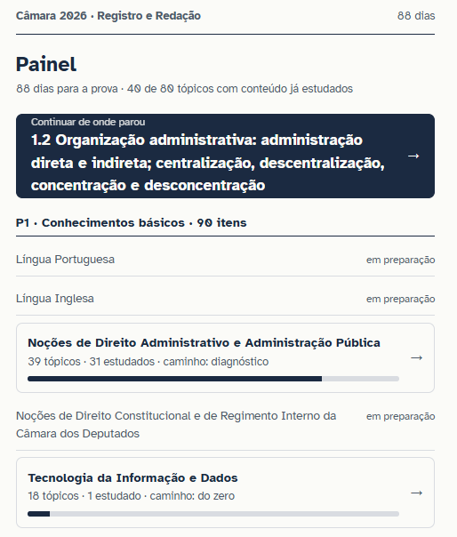
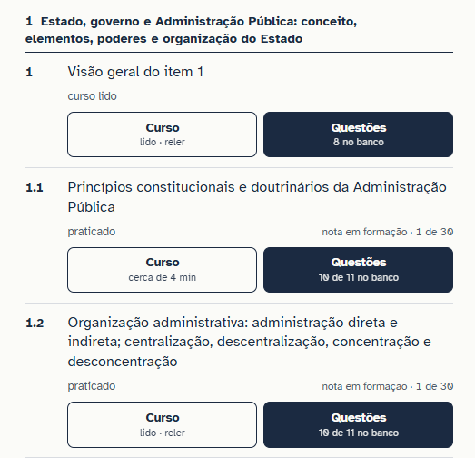
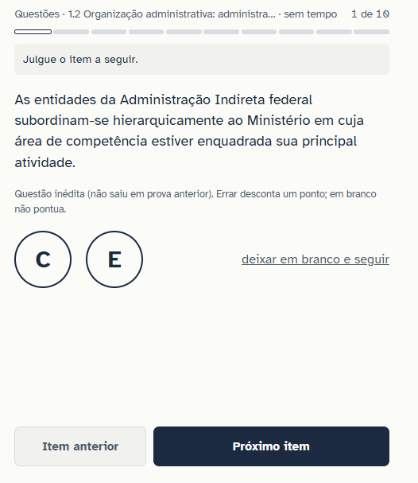
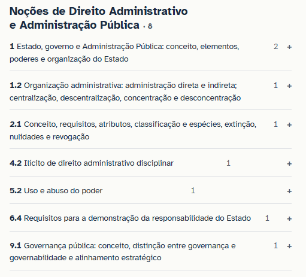
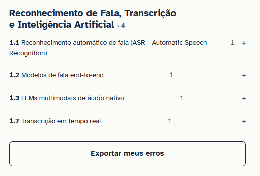
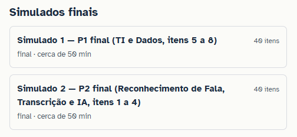
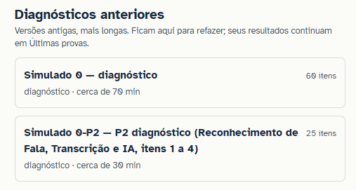
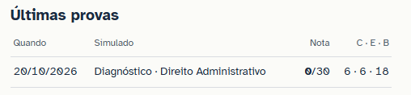

# ORDEM_V17_DESIGN.md — documento do Fundador "Prompt - Melhorias Gráficas de Design e Funcionalidades" (Word, 21/10/2026) — 2026-10-23 — gravado por orquestrador (sessão s17)
Origem: Downloads/Prompt_-_Melhorias_Gráficas_de_Design_e_Funcionalidades.docx (texto transcrito sem alteração; imagens em ordens/ORDEM_V17_DESIGN_anexos/, na posição em que aparecem no documento). Decisão: D-V17-DESIGN.

Aba Painel:Eu queria dar um espaço maior entre “Continuar de onde parou” e “P1 . Conhecimentos básicos”. Apenas para dar um respiro na tela, tornando a visualização mais acessível.

A questão do Diagnóstico deve ser apenas quando o candidato for fazer essa leitura pela primeira vez no aplicativo.

Para mensurar o desempenho, o candidato terá ferramentas como Simulados, conforme as regras da prova e o seu próprio Painel de Desempenho, mostrando sua nota na matéria e por tópico.

Nesse sentido, eu gostaria que quando o candidato clicasse (link) no título da matéria, por exemplo: “Noções de Direito Administrativo e Administração Pública”, aparecesse, logo abaixo, uma tabela com todos os tópicos, contendo as notas por tópico, curso e questões.

Na página inicial do Painel, eu gostaria de ver apenas a média ponderada dos tópicos daquela matéria, sendo esse valor apresentado logo à direita do título.

Em seguida, um espaço maior entre o último tópico da prova “P1 . Conhecimentos básicos” e a prova “P2.Conhecimentos específicos”. Apenas para dar um respiro na tela, tornando a visualização mais acessível.

Outro ponto importante é coloca à direito do título “P1” e “P2” a referente média, ponderada pelas suas matérias.

Por fim, na aba Painel, quero que apareça a Nota Final do candidato, ponderando os valores das provas P1 e P2, e seus respectivos pesos, mostrando a nota real, com até dois décimos.

Por fim, mais um espaço pequeno até chegar ao título “Prática de Prova” (P maiúsculo). Retirar a expressão “Sempre disponível, mesmo sem recomendação”. Logo abaixo, devem ter 3 botões: “Simulados”, “Discursivas” e “Lista da véspera (16/01/2026)”, modificando expressamente a forma de colocar a data.

Ainda dentro da aba Painel, ao clicar em alguma das matérias, não é necessário colocar essa frase: “18 tópicos com conteúdo, na ordem do edital.”, independente da matéria. Pode retirar essa expressão em todas.

A primeira vez que alguém clicar no tópico, ela deve escolher se faz o diagnóstico ou se escolhe caminho do zero. Depois dessa escolha, não existe necessidade de perguntar isso novamente e nem de mostrar possibilidade de alteração dessa escolha.

Ainda dentro da aba Painel, ao clicar em alguma das matérias, não é necessário colocar essa frase: “Nota do tópico: certo +1, errado −1, em branco 0, sobre as 30 questões diferentes do tópico respondidas mais recentemente. Antes disso, aparece “em formação”. A nota só é possível em tópicos com pelo menos 30 questões no banco.”, independente da matéria. Pode retirar essa expressão em todas.

 O botão de questões, dentro dos tópicos das matérias, não precisa informar quantas questões existe no banco. Pode retirar essa expressão em todas.

Nos tópicos das matérias, também não existe necessidade de informar coisas como “praticado” ou “curso lido”, mas apenas o tempo de leitura, mantendo essa informação. Também não existe necessidade de informar expressamente “nota em formação · 1 de 30”, independente da matéria e do tópico.

Ao responder questões, eu gostaria de acrescentar uma funcionalidade. Quando o candidato apertar “C” no teclado, deve marcar a alternativa “CERTO” e quando o candidato apertar “E” no teclado, deve marcar a alternativa “ERRADO”. Quando o candidato marcar “B”, deve ativar o botão “deixar em branco e seguir”.

Expressões como essa “Errar desconta um ponto; em branco não pontua.”, bem como a expressão “(não saiu em prova anterior)”, dentro das questões não são necessárias. Porém, a identificação de que aquela questão já foi cobrada e qual concurso foi cobrada é válida, assim como a expressão “Questão inédita”.

Durante a correção das questões, após fazer todas as questões, a expressão “Cada erro custou dois pontos em relação a deixar em branco.” Não é necessária e deve ser retirada.

Na Aba Erros, substituir a expressão original por “Cada erro só sai depois de dois acertos seguidos.” 

Na Aba Erros, devemos fazer o alinhamento vertical entre os tópicos e o seu número de questões erradas.

A ideia de exportar os erros pode ser uma boa inicialmente, mas a ideia final é que cada candidato tivesse o seu próprio login e senha para entrar no seu próprio painel personalizado. Em seguida, as informações referentes as suas notas e recomendações devem ser salvas dentro desse login e senha. Temos que pensar em como configurar isso.

Estou pensando em retirar a Aba “Resumos”, deixando os resumos disponíveis como se fossem um link que acompanha à direita, logo após o título do tópico.Assim, cada tópico teria 3 opções à direita: “Curso”, “Resumo” e “Questões”.

Podemos colocar essas opções como um botão clicável do tópico. Ou seja, ao clicar no tópico, abrem-se essas 3 opções para o candidato escolher. Assim, ao lado do tópico apareceria apenas o seu desempenho naquele tópico, calculado por meio das 30 questões que ele fez anteriormente. Inicialmente, os tópicos apareceriam valor “0%”.

Na parte dos simulados, retirar as expressões “final . cerca de 50 min”, fazendo isso para todos os simulados.

Substituir o título “Diagnósticos anteriores” por “Simulados anteriores”, colocando abaixo os simulados que foram feitos e as respectivas notas ao lado deles. Não existe necessidade de colocar esse tipo de expressão: “Versões antigas, mais longas. Ficam aqui para refazer; seus resultados continuam em Últimas provas.”

Retirar a parte “Últimas provas”

A parte das discursivas está ótima, mas deve ficar em uma tela diferente das dos simulados e, assim, como os simulados, devem aparecer as “Discursivas anteriores”
